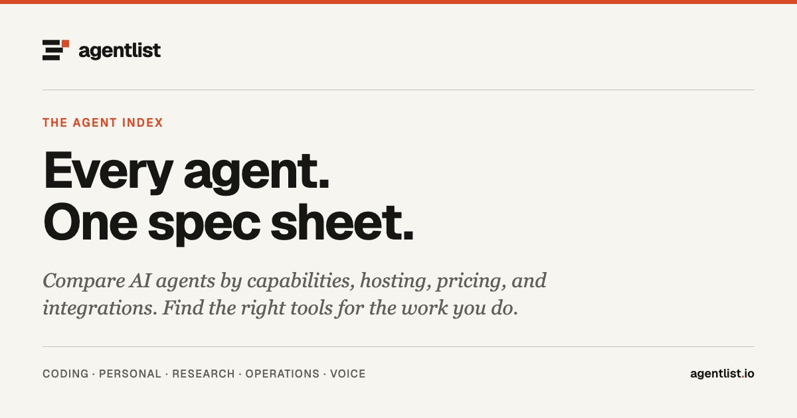

  

# A clearer view of what agents can do.

[agentlist.io](https://www.agentlist.io) is a catalog of AI agents with consistent spec sheets. Explore coding agents, personal assistants, digital coworkers, research tools, operations agents, and voice agents. Compare how they run, what they connect to, and what they can do.

**[Browse the catalog](https://www.agentlist.io/list-of-ai-agents) · [Compare agents](https://www.agentlist.io/compare) · [Explore categories](https://www.agentlist.io/categories)**

## The lists

| Collection | What you’ll find |
| --- | --- |
| [Awesome Agent List](https://github.com/AgentListIO/awesome-agent-list) | AI agents organized by category, with links to their full spec sheets. |
| [Awesome Personal Assistants](https://github.com/AgentListIO/awesome-personal-assistants) | Self-hosted assistants, skills, memory layers, and companion projects. |

## Use the catalog

Explore [capabilities](https://www.agentlist.io/capabilities) and [integrations](https://www.agentlist.io/integrations), follow updates through [RSS](https://www.agentlist.io/feed.xml), or work with the [JSON API](https://www.agentlist.io/api/v1/systems) and [agent-readable documentation](https://www.agentlist.io/llms.txt).

## Help keep it useful

[Suggest an agent or report a correction](https://github.com/AgentListIO/awesome-agent-list/issues/new). Include the project’s official URL, what should change, and a source we can check. For personal-assistant ecosystem projects, [contribute to the dedicated list](https://github.com/AgentListIO/awesome-personal-assistants/blob/main/CONTRIBUTING.md).

Entries are editorial records, not endorsements or paid placements. The lists are published under CC0; verify pricing and availability with the vendor before choosing a tool.
